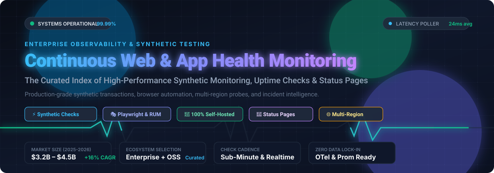

# 🚀 Awesome Continuous Web & App Health Monitoring

  

  
  
  
  
  
  

---

## 🧭 Overview & Ecosystem Scope

A comprehensive, SEO-optimized, curated directory of top **Synthetic Monitoring**, **Uptime Health Checks**, **Real-User Monitoring (RUM)**, and **Public Status Page** ecosystems for modern web applications, APIs, and microservices.

Whether you are managing multi-region global microservices or launching your first SaaS product, proactive continuous health checks simulate real user behavior across worldwide edge probe nodes. These tools detect outages, network jitter, broken API workflows, and silent front-end regressions before your customers report them.

---

## 📑 Table of Contents
- [📊 Sector Overview & Market Dynamics](#-sector-overview--market-dynamics)
- [☁️ SaaS & Hosted Platforms](#️-saas--hosted-platforms)
- [💻 Open-Source GitHub Projects](#-open-source-github-projects)
- [🛠️ Key Features to Look For](#️-key-features-to-look-for)
- [🤝 How to Contribute](#-how-to-contribute)
- [💖 Support & Sponsorship](#-support--sponsorship)
- [📈 Star History](#-star-history)
- [⚠️ Disclaimer](#️-disclaimer)

---

## 📊 Sector Overview & Market Dynamics

The global synthetic and continuous web application health monitoring sector is estimated at **$3.2 Billion to $4.5 Billion** (2025–2026), expanding at a rapid **~15% to 16.5% CAGR** driven by cloud-native microservices, shift-left testing, and distributed API dependencies.

The sector demonstrates **moderate market concentration with strong persistent fragmentation**: full-stack observability conglomerates (such as Datadog, Cisco/ThousandEyes, and Dynatrace) dominate enterprise consolidated budgets, yet high tooling fragmentation persists as agile SRE and developer teams embrace specialized code-first tools (like Checkly), lightweight availability pingers (Better Stack, UptimeRobot), and transparent self-hosted open-source stacks (such as Uptime Kuma and Gatus) to avert SaaS cost inflation and vendor lock-in.

---

## ☁️ SaaS & Hosted Platforms

*Below is the breakdown of leading SaaS continuous monitoring platforms, sorted in descending order by company scale (enterprise market capitalization, company valuation, and annual revenue).*

| Product | Scale & Valuation (Descending) | Description | Pricing (Starting Tier) | Free Tier & Free Trial Limits |
|:---|:---|:---|:---|:---|
| **[Datadog Synthetics](https://www.datadoghq.com/)** | **~$66B Market Cap** *(~$3.9B–$4.5B ARR)* | Enterprise-grade synthetic API & browser tests with deep APM tracing, distributed transaction tracing, and unified multi-cloud telemetry correlation. | **$5 per 10,000 API test runs/mo**; **$12 per 1,000 Browser runs/mo** (billed annually; requires base infrastructure host plan from $15/host/mo). | **No permanent free tier** for synthetics. **14-day full-feature free trial** with access to synthetics, APM, and host monitoring. |
| **[Zoho Site24x7](https://www.site24x7.com/)** | **~$12.5B Valuation** *(Zoho Corp ~$1.4B+ ARR; Site24x7 ~$52M ARR)* | Complete all-in-one IT infrastructure and web monitoring suite featuring a no-code transaction recorder across 130+ global test locations. | **$9/month** (Starter tier: 10 website/server monitors, 1 synthetic web transaction, 500MB logs). | **30-day free trial** with all features unlocked. Reverts to a limited **Free Forever plan**: 5 basic website monitors (HTTP/HTTPS/DNS) with 30-minute check intervals and 1 status page. |
| **[BrowserStack](https://www.browserstack.com/)** | **~$4.0B Valuation** *(~$225M ARR)* | Cross-browser real-device cloud test infrastructure, Playwright/Puppeteer/Selenium automation, and automated synthetic health checks. | **$99/month per parallel thread** (Automate Pro billed annually). | **No permanent free tier**. Offers **100 minutes of automated browser testing free trial** (single user) and free testing access for approved open-source repositories. |
| **[Pingdom (SolarWinds)](https://www.pingdom.com/)** | **~$3.2B Valuation** *(SolarWinds ~$800M ARR)* | Long-standing industry benchmark for global uptime polling, end-user synthetic transactions, page speed breakdown, and Real User Monitoring (RUM). | **$15/month** (Starter tier: 10 uptime checks, 1 synthetic transaction check, 50 SMS alerts). | **No permanent free tier**. Provides a **30-day free trial** (credit card required; auto-converts to paid Starter plan if not cancelled). |
| **[LambdaTest (TestMu AI)](https://www.lambdatest.com/)** | **~$400M Valuation** *(~$120M ARR)* | AI-augmented multi-cloud test execution grid, visual regression testing, Playwright synthetic probes, and production digital experience monitoring. | **$15/month** (Live plan); **$79/month** (Web Automation per parallel thread). | **Free Forever plan**: 100 free automation test minutes (lifetime allocation), 60 browser test minutes/month, and 1 responsive test tunnel. |
| **[Checkly](https://www.checklyhq.com/)** | **~$150M Valuation** *(~$7.3M ARR; $32M raised)* | Developer-centric Monitoring-as-Code (MaC) platform built entirely around Playwright & TypeScript, featuring CLI git workflows and bi-directional CI/CD triggers. | **$24/month** (Starter tier: 50 uptime monitors, 3,000 browser check runs/mo, 25,000 API check runs/mo, 4 check locations). | **Free Forever (Hobby Plan)**: 10 uptime monitors, 1,000 Playwright browser check runs/mo, 10,000 API check runs/mo, 1 user seat, and 7-day data retention. |
| **[Better Stack Uptime](https://betterstack.com/)** | **~$80M Valuation** *(~$3.8M ARR; $28M raised)* | High-aesthetic uptime monitoring with instant phone-call escalation, on-call scheduling, unified incident management, and hosted public status pages. | **$29/month** (Freelancer tier: 50 monitors, 30-second check intervals, 5 SMS/phone alerts, 5 status pages). | **Free Forever plan**: 10 website/API monitors, 10 heartbeat monitors, 3-minute check intervals, 1 status page, and 3 GB logs with 3-day retention. |
| **[Sematext](https://sematext.com/)** | **Bootstrapped / PE-Backed** *(~$2.8M ARR)* | Predictable flat per-monitor synthetic health probes, browser automation without per-run billing shock, API validation, and full ELK-compatible log management. | **$2/month per HTTP monitor** and **$7/month per browser synthetic monitor** (flat monthly billing per check, 30-day retention). | **14-day unlimited free trial** for Synthetics. Permanent **Free tier** applies to logs (500 MB/day, 7-day retention) and basic host infrastructure metrics (up to 5 nodes). |
| **[UptimeRobot](https://uptimerobot.com/)** | **Private / Bootstrapped** *(~$1M–$3M ARR)* | Simple, reliable, widely adopted uptime and ping monitoring tracking HTTP(s), port, ping, keyword, and SSL certificate expiration. | **$7/month** (Solo Pro tier billed annually: 10 monitors, 1-minute check intervals, 20 SMS/voice credits). | **Free Forever plan**: 50 monitors, 5-minute check intervals, 3 status pages, HTTP(s) and ping checks, and email alerts. |

---

## 💻 Open-Source GitHub Projects

*Self-hosted, transparent, zero-vendor-lock-in monitoring engines and status pages. Ranked in descending order by GitHub Star count.*

| Repository | GitHub Stars | Check Types & Capabilities | Tech Stack & Deployment | License |
|:---|:---|:---|:---|:---|
| **[Uptime Kuma](https://github.com/louislam/uptime-kuma)** |  | HTTP(s), TCP, Ping, DNS, Push/Heartbeat, Steam Game Server, Docker container status, 20s interval checks, beautiful embedded status page with multi-incident support. | Node.js, Vue.js, SQLite (Single Docker container) | MIT |
| **[Upptime](https://github.com/upptime/upptime)** |  | Serverless uptime monitor & status page powered entirely by GitHub Actions and GitHub Pages; opens Git issues on failure and commits latency graphs. | GitHub Actions, Git, Svelte / Markdown | MIT |
| **[Cachet](https://github.com/cachethq/cachet)** |  | The classic open-source incident communication and status page system with scheduled maintenance, component grouping, metric graphs, and two-factor auth. | PHP, Laravel, PostgreSQL/MySQL, Docker | BSD-3-Clause |
| **[Gatus](https://github.com/TwiN/gatus)** |  | Ultra-lightweight automated developer status dashboard with alerting; evaluates HTTP/TCP/ICMP/DNS response statuses, headers, and payload conditions. | Go (single binary), YAML config-as-code, Docker | Apache-2.0 |
| **[Checkmate](https://github.com/bluewave-labs/Checkmate)** |  | Self-hosted monitoring dashboard tracking server hardware metrics, service uptime, ping response latencies, and incidents with real-time charts. | Go, React, Tailwind CSS, Docker | Apache-2.0 |
| **[OpenStatus](https://github.com/openstatusHQ/openstatus)** |  | Modern synthetic monitoring engine and custom status pages running on 300+ edge locations; supports incident workflows, public status pages, and webhooks. | Next.js, Cloudflare Workers / Fly.io, Tailwind CSS | AGPL-3.0 |
| **[OneUptime](https://github.com/OneUptime/oneuptime)** |  | Complete open-source observability suite combining synthetic uptime monitors, incident management, on-call alert schedules, status pages, and OpenTelemetry logs. | TypeScript, Node.js, Kubernetes, Docker | Apache-2.0 |
| **[Apache HertzBeat](https://github.com/apache/hertzbeat)** |  | AI-powered, agentless real-time monitoring system supporting web apps, APIs, microservices, databases, OS metrics, and threshold alarm dispatching. | Java, Spring Boot, Vue 3, Docker | Apache-2.0 |
| **[Statping](https://github.com/statping/statping)** |  | Standalone status page with built-in monitoring checks, responsive mobile-friendly dashboard, charts, Telegram/Slack alerts, and offline event logging. | Go, HTML/JS, SQLite/MySQL/PostgreSQL | GPL-3.0 |
| **[Kener](https://github.com/rajnandan1/kener)** |  | Sleek, modern status page with automated synthetic health checks, badge generation, YAML/JSON configuration, and zero-database setup option. | Node.js, SvelteKit, Redis / In-memory, Docker | MIT |
| **[Tianji](https://github.com/msgbyte/tianji)** |  | All-in-one developer workspace bringing website analytics, HTTP/TCP uptime monitoring, and server node performance telemetry together into a unified UI. | Node.js, React, Prisma, Docker | AGPL-3.0 |
| **[cstate](https://github.com/cstate/cstate)** |  | Ultra-fast, minimal, serverless static status page powered by Hugo; generates read-only API endpoints and status badges with zero backend dependencies. | Hugo (Go-based static generator), JAMstack | MIT |
| **[Supercheck](https://github.com/supercheck-io/supercheck)** |  | AI-assisted end-to-end testing and production synthetic monitoring framework; execute Playwright browser scripts against production with alerting. | TypeScript, Playwright, Docker | Apache-2.0 |

---

## 🛠️ Key Features to Look For

When choosing a continuous health monitoring platform, evaluate solutions across these core dimensions:

1. **Check Granularity & Cadence:** Does the tool support 30-second or 1-minute test frequencies, or are you locked into a 5-minute floor?
2. **Multi-Step Synthetic Transactions:** Can it execute multi-step browser flows (login, shopping cart checkout, OAuth redirect) with headless Playwright or Chromium?
3. **Global Probe Distribution:** Does the provider probe endpoints from 50+ geographically distributed regions to catch routing and CDN issues?
4. **Alert Escalation & Integrations:** Instant multi-channel notifications via Slack, Microsoft Teams, Discord, Telegram, Webhooks, PagerDuty, SMS, or automated voice calls.
5. **Config-as-Code (MaC):** Ability to define test suites, check rules, and alert thresholds in TypeScript or YAML directly inside your Git repositories.
6. **Data Privacy & Compliance:** Self-hosted open-source deployments for air-gapped environments or strict GDPR/HIPAA compliance requirements.

---

## 🤝 How to Contribute

Contributions are warmly welcomed! Help make this the most comprehensive and accurate directory on web and app health monitoring:

1. 🍴 **Fork the repository** to your GitHub account.
2. 🌿 **Create a descriptive feature branch**: `git checkout -b add-monitoring-tool`.
3. 📝 **Edit `README.md`**: Follow the existing tabular structure, ensuring pricing and free tier specs are concrete and accurate.
4. 🌟 **Add official star badges** for open-source repositories linking to their respective stargazers page.
5. 🚀 **Submit a Pull Request** with a brief summary of the added or updated tools.

---

## 💖 Support & Sponsorship

If this curated ecosystem guide helped you select a health monitoring architecture or save infrastructure costs, please consider supporting the project:

- ⭐ **Star this repository** on GitHub to help other engineers discover it.
- 🍴 **Fork and share** with your DevOps, SRE, and engineering teams.
- ☕ **Buy me a coffee / Sponsor the maintainer** via GitHub Sponsors:  
  👉 **[Sponsor @ishandutta2007 on GitHub Sponsors](https://github.com/sponsors/ishandutta2007)**

Your generous sponsorship keeps this directory actively researched, updated, and independent. Thank you! 🙌

---

## 📈 Star History

---

## ⚠️ Disclaimer

- This repository is a community-curated educational index. Mentions of vendors, trademarks, and open-source projects do not imply official endorsement or affiliation.
- Synthetic testing scripts probe live staging and production systems. Always configure dedicated monitoring test accounts, sanitize sensitive credentials, and configure appropriate web application firewall (WAF) bypass tokens to prevent inadvertent service degradation.
- SaaS vendor pricing and plan specifications change over time. Please verify current subscription rates and quota terms directly on official vendor pricing pages.

---

  <b>Built with ❤️ for Site Reliability Engineers, DevOps teams, Platform architects, and Web developers worldwide.</b>

